> **关于这份文件**：这是 [`report.html`](report.html) 的 Markdown 版 —— GitHub 会直接渲染 Markdown 和图片，所以在这里能当场看到全部图表。
>
> **数据版本**：本报告是 **0.3.0 时期**跑的同机横向评测（六个库对比），图表与数字都没有随 `0.3.1`
> 重跑；`0.3.1` 执行层重写后的异步吞吐数据见根目录 README 的「模拟能力与性能」一节。
>
> 想要一个独立页面（带完整样式、可离线打开、方便分享）用 `report.html`：[在线预览](https://htmlpreview.github.io/?https://github.com/touxigua00/nb-curl/blob/main/benchmarks/report.html) · [源文件](report.html)。
>
> 下面是同一份报告的内容，数字与报告完全一致。

# nb-curl 横向对比评测报告

*Functionality & Performance Benchmark · 与 requests / aiohttp / httpx / curl_cffi / requests_go 对比*

[1. 测试环境与方法](#1-测试环境与方法) · [2. 功能对比](#2-功能对比) · [3. 性能对比](#3-性能对比) · [4. 指纹评分](#4-请求指纹评分) · [5. HTTP/3](#5-http3) · [6. 公平性与局限](#6-公平性与局限) · [7. 结论](#7-结论)

## 1. 测试环境与方法

### 测试拓扑

| 角色 | 配置 |
| --- | --- |
| 客户端 | 与服务端<b>同一台机器</b> · 绑核 8-47 · Python 3.11.17 |
| 服务端 | 同机 · 绑核 0-7 · 48 逻辑核 · Ubuntu 22.04 · 62 GB 内存 |
| 通信路径 | 本机回环（loopback），实测可用带宽约 20 Gbit/s —— 网络这一维被消掉，量的就是库本身 |
| 服务端程序 | 自研 asyncio 测试服务（框架无关，HTTP/1.1 + HTTP/2，4 进程 SO_REUSEPORT，端口 8080 / 8443） |
| 被测库 | requests 2.34.2 · aiohttp 3.14.4 · httpx 0.28.1 · curl_cffi 0.16.3 · requests_go 1.0.9 · <b>nb-curl 0.3.0</b>（均从 PyPI 安装） |
| 服务端负载 | 逐单元采样服务端 CPU；全程最高 3.8%（服务端远未打满，客户端才是瓶颈） |

### 方法要点

- **同机回环 + 两侧绑核**：客户端与服务端跑在同一台 48 核机器上，客户端绑 8–47、服务端绑 0–7，走 loopback。跨机的网络链路其带宽与延迟抖动会盖过库之间的真实差距，同机绑核把这一维直接消掉 —— 这是本次排名的唯一依据。
- **各用各的自然用法**：同步库用线程池驱动、异步库用 asyncio 驱动，不假装某一种模型普遍更优。
- **并发 = 连接数**：每个工作线程持有自己的连接池会话，并发 C 即 C 条池化连接，各库一致。
- **预热 + 多次取中位**：先跑 1 s 丢弃，再重复 5 次每次 4 s，取中位数那一次作为该单元结果，并给出 5 次的最小值/四分位距看抖动。
- **漂移控制组**：每 10 个测量单元插入一个固定参照单元（requests · 并发 8），用首尾差异监视整台机器在长跑过程中的状态漂移（阈值 5%）。
- **服务端独立计数 + 对账**：每个服务端进程各自汇报连接数/请求数/字节数，与客户端计数对账（reconcile），并据此算出链路占用率，确认没有撞带宽天花板。
- **CPU-ms/请求**：客户端进程 CPU 时间除以完成请求数，衡量每请求的真实处理开销。
- **同预设立场**：curl_cffi 与 nb-curl 都用两者共有的最新 Chrome 预设（chrome150），避免用不同版本的模拟目标制造差异。
- **证书校验姿态六库一致**：服务端是本地自签证书端点，六个库统一以 `verify=False` 连接。TLS 场景因此量的是传输与模拟成本，六个库一视同仁；证书校验开关的行为与版本相关，不在本次测量范围内。H1 场景完全不涉及 TLS，不受这一项影响。
- **为每个库找对它自己的正确用法。**requests_go 若被配成手工挂载 `TLSAdapter`，会话 id 会与 TLS 配置失联、连接复用失效，每个请求都重做一次 TLS 握手 —— HTTPS 场景只有 33 req/s；改用官方预设（`s.tls_config = TLS_CHROME_LATEST`）后同一场景是 2000+ req/s。**配置错误的代价远大于库之间的真实差距**，所以每个库都按其官方推荐方式配置、复核过才计入结果。

## 2. 功能对比

### 功能矩阵

每一项都用真实请求验证，不引用各库文档。绿色为完整支持，黄色为部分支持，灰色为该库不提供这项能力。

| 库 | F1 TLS 协商 | F2 连接复用 | F3 自动解压 | F4 重定向 | F5 Cookie | F6 超时 | F7 流式下载 | F8 HTTP 代理 | F9 WebSocket |
| --- | --- | --- | --- | --- | --- | --- | --- | --- | --- |
| requests | h1 ✓ | ✓ | 2/4 | ✓ | ✓ | ✓ | ✓ | ✓ | 无此能力 |
| aiohttp | h1 ✓ | ✓ | 2/4 | ✓ | ✓ | ✓ | ✓ | ✓ | ✓ |
| httpx | h1 ✓ | ✓ | 2/4 | ✓ | ✓ | ✓ | ✓ | ✓ | 无此能力 |
| httpx(h2) | h2 ✓ | ✓ | 2/4 | ✓ | ✓ | ✓ | ✓ | ✓ | 无此能力 |
| curl_cffi | h2 ✓ | ✓ | 4/4 | ✓ | ✓ | ✓ | ✓ | ✓ | ✓ |
| requests_go | h2 ✓ | ✓ | 2/4 | ✓ | ✓ | ✓ | ✓ | ✓ | 无此能力 |
| nb_curl | h2 ✓ | ✓ | 4/4 | ✓ | ✓ | ✓ | ✓ | ✓ | ✓ |

*图例：绿 = 完整支持，黄 = 部分支持 / 有保留，红 = 不支持，灰 = 该库不提供这项能力。*

### 关键差异说明

- **TLS/HTTP2 协商**：默认即走 HTTP/2 的：httpx(h2)、curl_cffi、requests_go、nb_curl；只走 HTTP/1.1 的：requests、aiohttp、httpx。httpx 需显式开启 http2，本报告对 httpx 同时测了 h1 与 h2 两种配置。
- **WebSocket**：内置 WebSocket 客户端且实测可用的：aiohttp、curl_cffi、nb_curl。其余需要额外的第三方 WebSocket 库。
- **压缩解码**：对 gzip / deflate / br / zstd 四种 Content-Encoding 的自动解码覆盖情况见上表。

### 逐库细节

**requests** TLS ALPN = `http/1.1`（HTTP/1.1） · 代理：直连 HTTP 代理可用 · WebSocket：无内置能力

**aiohttp** TLS ALPN = `http/1.1`（HTTP/1.1） · 代理：直连 HTTP 代理可用 · WebSocket：可用

**httpx** TLS ALPN = `http/1.1`（HTTP/1.1） · 代理：直连 HTTP 代理可用 · WebSocket：无内置能力

**httpx(h2)** TLS ALPN = `h2`（HTTP/2） · 代理：直连 HTTP 代理可用 · WebSocket：无内置能力

**curl_cffi** TLS ALPN = `h2`（HTTP/2） · 代理：直连 HTTP 代理可用 · WebSocket：可用

**requests_go** TLS ALPN = `h2`（HTTP/2） · 代理：直连 HTTP 代理可用 · WebSocket：无内置能力

**nb_curl** TLS ALPN = `h2`（HTTP/2） · 代理：直连 HTTP 代理可用 · WebSocket：可用

## 3. 性能对比

### 3.0 先看数据可不可信

排名之前先确认这堆数字没有被测量环境本身污染：机器在长跑里有没有漂、服务端计数和客户端对不对得上、有没有撞到回环带宽、服务端是不是瓶颈。

| 指标 | 数值 | 备注 |
| --- | --- | --- |
| 长跑漂移（控制组首尾） | **-7.12%** | 9 个参照点 |
| 客户端/服务端请求数对账偏差（中位） | **0.00%** | 越小越可信 |
| 最高链路占用率 | **12.62%** | 回环约 20 Gbit/s |
| 服务端 CPU 峰值 | **3.8%** | 全机占用 |

*漂移控制组（requests · 并发 8，每 10 个单元插一次）：1044 → 976 → 1126 → 988 → 1112 → 1000 → 996 → 990 → 970 req/s，共 9 个参照点。⚠ 首尾差异超过 5%，存在漂移，请谨慎看待跨时段差异。对账偏差为「客户端计数 − 服务端计数」占客户端计数的比例，越接近 0 说明两边数的是同一批请求。*

### 3.1 并发吞吐曲线（明文 HTTP/1.1，128 字节响应）

横轴为并发连接数，纵轴为每秒完成请求数。这是最能看出「一个库的调度效率」的一张图：低并发段看单连接开销，高并发段看上下文切换与调度成本。

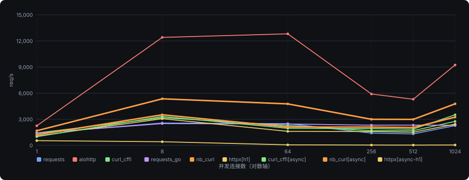

*取 5 次重复的中位数；预热 1 s 后计时 4 s。实线包含同步与异步两种变体。*

### 3.2 各并发档位吞吐（每库默认配置）

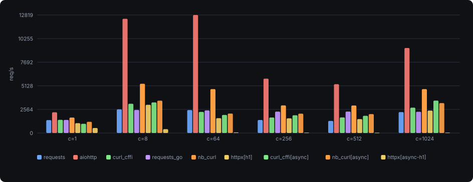

*同一份数据的柱状视图，便于逐档对比。httpx 取 HTTP/1.1 同步配置。*

### 3.3 延迟分位（并发 64）

吞吐高不代表体验稳。这里给出 p50 / p95 / p99 —— 中位数看常态，p99 看最差的那 1% 请求。

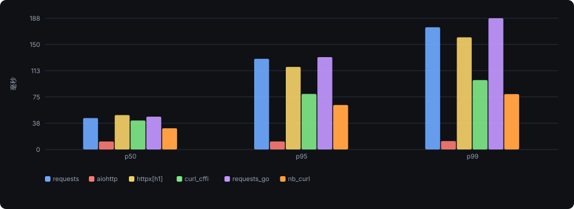

*并发 64 下的响应延迟分位（毫秒，越低越好）。*

### 3.4 CPU 效率（每请求客户端 CPU 毫秒，并发 64）

用客户端进程 CPU 时间除以完成请求数。这个数越低，说明单位请求的 CPU 开销越小，越能在相同的机器上压出更高的吞吐。浏览器仿真需要做更多工作，这个指标能直接量化其代价。

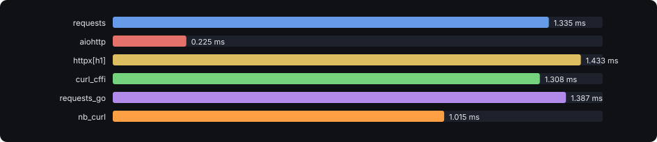

### 3.5 HTTPS 场景：连接复用 vs 每请求新建连接

#### HTTPS · 连接复用 · 并发 8

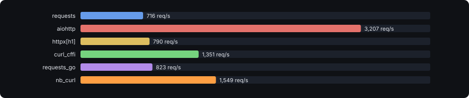

#### HTTPS · 每请求新建连接 · 并发 8（考验 TLS 握手开销）

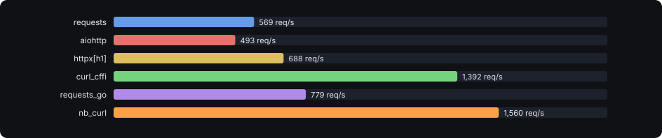

*握手是 TLS 场景的主要成本。仿真库要按浏览器顺序发送 ClientHello 扩展，这里能看出这份额外工作值多少吞吐。*

### 3.6 HTTP/2（并发 32，单连接多路复用）

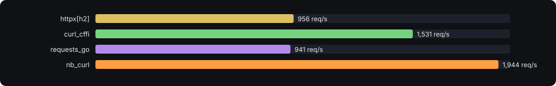

*只列出支持 HTTP/2 的库与其配置。HTTP/2 下并发由单条连接上的流承载。*

### 3.7 同步 / 异步两种模型的差距

同一批库在自己最擅长的模型下的表现，取并发 256 一档。这不是公平不公平的问题，而是选型时必须知道的现实。

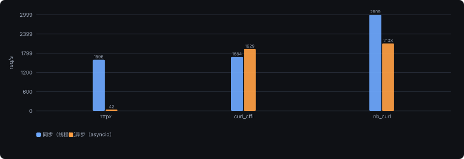

*并发 256。左侧为默认同步配置，右侧为该库的异步变体（asyncio 协程池）。*

### 3.8 大响应体（64 KB，并发 8）

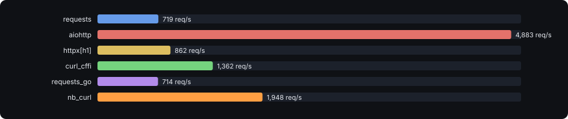

*响应体从 128 字节扩大到 64 KB。此档重点看各库搬运数据的效率；最高链路占用率 12.6%，回环带宽充裕、未成瓶颈。*

### 3.9 每请求新建连接（并发 8）

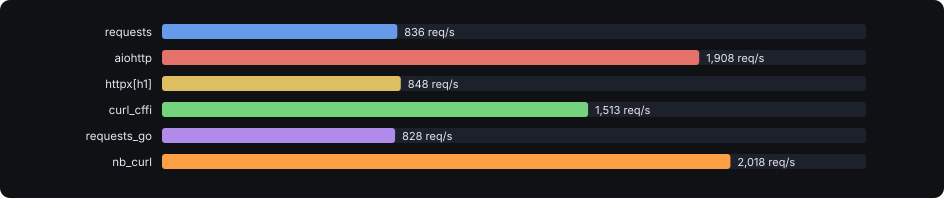

*服务端每答一个请求就关闭连接，连接池与复用完全失效 —— 这一档量的是「建连 + 首字节」的固定成本。*

### 3.10 浏览器指纹仿真的代价（并发 8）

把 curl_cffi 与 nb-curl 切换到**不做指纹仿真**的普通配置，与它们各自带 chrome150 预设时对比。两者之差就是「TLS/HTTP2 指纹对齐」这件事本身的成本。

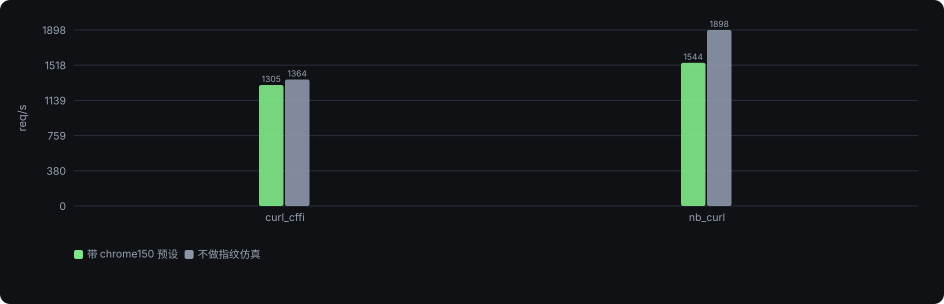

*并发 8，明文 HTTP/1.1。指纹仿真主要在 TLS 握手与请求头构造上付出额外 CPU；连接复用场景下这部分成本被摊薄。*

### 3.11 全量数据表

| 库 | 模型 | 场景 | req/s | p50 | p95 | p99 | CPU-ms/req | 服务端CPU% | 对账偏差% | 链路占用% | 错误 |
| --- | --- | --- | --- | --- | --- | --- | --- | --- | --- | --- | --- |
| requests | sync | h1_c1 | 1,195 | 0.834 | 0.848 | 0.853 | 0.7691 | 0.4 | 0.00 | 0.0 | — |
| aiohttp | async | h1_c1 | 2,313 | 0.405 | 0.553 | 0.621 | 0.3077 | 1.1 | 0.00 | 0.0 | — |
| httpx[h1] | sync | h1_c1 | 1,431 | 0.686 | 0.703 | 0.944 | 0.653 | 0.5 | 0.00 | 0.0 | — |
| curl_cffi | sync | h1_c1 | 1,720 | 0.579 | 0.591 | 0.595 | 0.4414 | 0.7 | 0.00 | 0.0 | — |
| requests_go | sync | h1_c1 | 1,150 | 0.87 | 0.889 | 0.894 | 0.7993 | 0.4 | 0.00 | 0.0 | — |
| nb_curl | sync | h1_c1 | 1,909 | 0.523 | 0.537 | 0.542 | 0.3891 | 0.8 | 0.00 | 0.0 | — |
| httpx[async-h1] | async | h1_c1 | 639 | 1.563 | 1.62 | 1.777 | 1.5278 | 0.3 | 0.00 | 0.0 | — |
| curl_cffi[async] | async | h1_c1 | 1,030 | 0.921 | 1.139 | 1.159 | 0.7972 | 0.7 | 0.00 | 0.0 | — |
| nb_curl[async] | async | h1_c1 | 1,227 | 0.758 | 1.047 | 1.17 | 0.6652 | 0.6 | 0.00 | 0.0 | — |
| requests | sync | h1_c8 | 1,004 | 7.139 | 15.648 | 20.867 | 1.0783 | 0.5 | 0.00 | 0.0 | — |
| aiohttp | async | h1_c8 | 5,670 | 1.402 | 1.503 | 1.528 | 0.1764 | 1.8 | 0.00 | 0.0 | — |
| httpx[h1] | sync | h1_c8 | 1,102 | 6.695 | 13.477 | 17.542 | 1.003 | 0.5 | 0.00 | 0.0 | — |
| curl_cffi | sync | h1_c8 | 1,566 | 4.835 | 8.572 | 10.547 | 1.0299 | 0.8 | 0.00 | 0.0 | — |
| requests_go | sync | h1_c8 | 963 | 7.342 | 16.865 | 22.453 | 1.1244 | 0.4 | 0.00 | 0.0 | — |
| nb_curl | sync | h1_c8 | 1,972 | 3.826 | 7.179 | 9.031 | 0.7961 | 1.0 | 0.00 | 0.0 | — |
| httpx[async-h1] | async | h1_c8 | 394 | 10.06 | 10.655 | 13.744 | 2.5402 | 0.2 | 0.00 | 0.0 | — |
| curl_cffi[async] | async | h1_c8 | 1,898 | 4.21 | 4.769 | 4.952 | 0.5267 | 0.9 | 0.00 | 0.0 | — |
| nb_curl[async] | async | h1_c8 | 1,548 | 5.011 | 7.885 | 9.395 | 0.9733 | 0.8 | 0.00 | 0.0 | — |
| curl_cffi[nofp] | sync | h1_c8 | 1,578 | 4.77 | 8.855 | 10.93 | 0.9984 | 0.6 | 0.00 | 0.0 | — |
| nb_curl[nofp] | sync | h1_c8 | 2,511 | 2.871 | 6.421 | 8.46 | 0.6496 | 1.1 | 0.00 | 0.0 | — |
| requests | sync | h1_c64 | 1,001 | 44.925 | 129.791 | 174.895 | 1.1302 | 0.6 | 0.00 | 0.0 | — |
| aiohttp | async | h1_c64 | 5,577 | 11.42 | 11.476 | 11.977 | 0.1793 | 1.9 | 0.00 | 0.0 | — |
| httpx[h1] | sync | h1_c64 | 1,037 | 49.259 | 118.178 | 160.495 | 1.1193 | 0.6 | 0.00 | 0.0 | — |
| curl_cffi | sync | h1_c64 | 1,404 | 41.52 | 79.504 | 99.278 | 1.1886 | 0.8 | 0.00 | 0.0 | — |
| requests_go | sync | h1_c64 | 979 | 46.98 | 132.2 | 187.841 | 1.1523 | 0.6 | 0.00 | 0.0 | — |
| nb_curl | sync | h1_c64 | 1,877 | 30.376 | 63.683 | 79.215 | 0.8598 | 1.1 | 0.00 | 0.0 | — |
| httpx[async-h1] | async | h1_c64 | 84 | 422.255 | 2070.928 | 3016.61 | 11.9084 | 0.0 | 0.00 | 0.0 | — |
| curl_cffi[async] | async | h1_c64 | 1,884 | 5.394 | 5.444 | 6.475 | 0.5307 | 0.7 | 0.00 | 0.0 | — |
| nb_curl[async] | async | h1_c64 | 1,489 | 42.814 | 45.309 | 46.556 | 0.9965 | 0.8 | 0.00 | 0.0 | — |
| requests | sync | h1_c256 | 1,001 | 50.716 | 160.344 | 231.731 | 1.1399 | 0.5 | 0.00 | 0.0 | — |
| aiohttp | async | h1_c256 | 5,027 | 50.691 | 51.216 | 79.63 | 0.1989 | 1.7 | 0.00 | 0.0 | — |
| httpx[h1] | sync | h1_c256 | 990 | 57.846 | 161.208 | 220.641 | 1.2053 | 0.5 | 0.00 | 0.0 | — |
| curl_cffi | sync | h1_c256 | 1,350 | 92.323 | 207.102 | 267.97 | 1.2667 | 0.9 | 0.00 | 0.0 | — |
| requests_go | sync | h1_c256 | 938 | 51.359 | 164.82 | 239.444 | 1.2149 | 0.6 | 0.00 | 0.0 | — |
| nb_curl | sync | h1_c256 | 1,824 | 61.447 | 143.598 | 192.306 | 0.8946 | 1.1 | 0.00 | 0.0 | — |
| httpx[async-h1] | async | h1_c256 | 42 | 4571.286 | 9715.853 | 9868.169 | 24.0547 | 0.0 | 0.00 | 0.0 | — |
| curl_cffi[async] | async | h1_c256 | 1,732 | 5.807 | 6.516 | 4096.233 | 0.5773 | 0.8 | 0.00 | 0.0 | — |
| nb_curl[async] | async | h1_c256 | 1,457 | 175.048 | 178.394 | 179.716 | 1.0169 | 0.8 | 0.00 | 0.0 | — |
| requests | sync | h1_c512 | 968 | 55.531 | 178.908 | 263.675 | 1.1867 | 0.6 | 0.00 | 0.0 | — |
| aiohttp | async | h1_c512 | 5,232 | 93.206 | 103.45 | 169.227 | 0.1911 | 1.8 | 0.00 | 0.0 | — |
| httpx[h1] | sync | h1_c512 | 965 | 68.253 | 196.779 | 276.919 | 1.264 | 0.6 | 0.00 | 0.0 | — |
| curl_cffi | sync | h1_c512 | 1,326 | 97.45 | 213.895 | 269.652 | 1.2855 | 0.8 | 0.00 | 0.0 | — |
| requests_go | sync | h1_c512 | 949 | 50.639 | 160.202 | 239.128 | 1.2046 | 0.5 | 0.00 | 0.0 | — |
| nb_curl | sync | h1_c512 | 1,787 | 63.299 | 151.258 | 203.753 | 0.9082 | 1.1 | 0.00 | 0.0 | — |
| httpx[async-h1] | async | h1_c512 | 35 | 13059.394 | 16915.265 | 17247.519 | 28.9116 | 0.0 | 0.00 | 0.0 | — |
| curl_cffi[async] | async | h1_c512 | 1,723 | 5.815 | 4069.081 | 4237.034 | 0.5804 | 0.8 | 0.00 | 0.0 | — |
| nb_curl[async] | async | h1_c512 | 1,464 | 347.767 | 351.833 | 353.603 | 1.0136 | 0.8 | 0.00 | 0.0 | — |
| requests | sync | h1_c1024 | 952 | 53.261 | 175.531 | 265.946 | 1.2074 | 0.5 | 0.00 | 0.0 | — |
| aiohttp | async | h1_c1024 | 4,664 | 199.118 | 319.239 | 401.42 | 0.2144 | 1.7 | 0.00 | 0.0 | — |
| httpx[h1] | sync | h1_c1024 | 910 | 65.693 | 180.169 | 251.435 | 1.3628 | 0.5 | 0.00 | 0.0 | — |
| curl_cffi | sync | h1_c1024 | 1,290 | 92.841 | 212.751 | 275.343 | 1.3088 | 0.8 | 0.00 | 0.0 | — |
| requests_go | sync | h1_c1024 | 917 | 49.382 | 154.245 | 222.73 | 1.2469 | 0.5 | 0.00 | 0.0 | — |
| nb_curl | sync | h1_c1024 | 1,726 | 63.348 | 153.442 | 207.084 | 0.9343 | 1.1 | 0.00 | 0.0 | — |
| httpx[async-h1] | async | h1_c1024 | 34 | 31341.359 | 31838.804 | 31888.607 | 29.6443 | 0.0 | 0.00 | 0.0 | — |
| curl_cffi[async] | async | h1_c1024 | 1,740 | 5.794 | 4332.876 | 4490.682 | 0.5748 | 0.8 | 0.00 | 0.0 | — |
| nb_curl[async] | async | h1_c1024 | 1,455 | 698.448 | 711.366 | 713.755 | 1.0195 | 0.8 | 0.00 | 0.0 | — |
| requests | sync | h1_k64_c8 | 719 | 10.82 | 16.319 | 19.207 | 1.6036 | 0.4 | 0.00 | 1.9 | — |
| aiohttp | async | h1_k64_c8 | 4,883 | 1.632 | 1.659 | 1.763 | 0.2048 | 1.9 | 0.00 | 12.6 | — |
| httpx[h1] | sync | h1_k64_c8 | 862 | 8.767 | 15.707 | 18.903 | 1.3219 | 0.5 | 0.00 | 2.2 | — |
| curl_cffi | sync | h1_k64_c8 | 1,362 | 5.738 | 8.626 | 10.173 | 1.1702 | 0.8 | 0.00 | 3.5 | — |
| requests_go | sync | h1_k64_c8 | 714 | 10.764 | 17.097 | 20.795 | 1.6103 | 0.4 | 0.00 | 1.8 | — |
| nb_curl | sync | h1_k64_c8 | 1,948 | 3.817 | 7.272 | 9.253 | 0.8441 | 1.1 | 0.00 | 5.0 | — |
| requests | sync | h1_close_c8 | 836 | 9.24 | 14.702 | 17.631 | 1.4424 | 0.9 | 0.00 | 0.0 | — |
| aiohttp | async | h1_close_c8 | 1,908 | 4.158 | 4.551 | 4.722 | 0.5237 | 1.6 | 0.00 | 0.0 | — |
| httpx[h1] | sync | h1_close_c8 | 848 | 9.09 | 14.146 | 16.722 | 1.4364 | 0.9 | 0.00 | 0.0 | — |
| curl_cffi | sync | h1_close_c8 | 1,513 | 5.083 | 8.342 | 9.994 | 1.217 | 1.6 | 0.00 | 0.0 | — |
| requests_go | sync | h1_close_c8 | 828 | 9.363 | 14.554 | 17.349 | 1.4451 | 0.9 | 0.00 | 0.0 | — |
| nb_curl | sync | h1_close_c8 | 2,018 | 3.719 | 6.748 | 8.427 | 0.9212 | 2.1 | 0.00 | 0.0 | — |
| requests | sync | tls_c8 | 881 | 8.076 | 16.024 | 21.207 | 1.2615 | 0.6 | 0.00 | 0.0 | — |
| aiohttp | async | tls_c8 | 4,347 | 1.828 | 1.875 | 1.961 | 0.23 | 2.1 | 0.00 | 0.0 | — |
| httpx[h1] | sync | tls_c8 | 1,020 | 6.932 | 15.235 | 20.638 | 1.0971 | 0.7 | 0.00 | 0.0 | — |
| curl_cffi | sync | tls_c8 | 1,623 | 4.77 | 7.474 | 8.878 | 1.0445 | 2.2 | 0.00 | 0.0 | — |
| requests_go | sync | tls_c8 | 965 | 8.033 | 13.804 | 16.938 | 3.0796 | 1.1 | 0.00 | 0.0 | — |
| nb_curl | sync | tls_c8 | 2,091 | 3.35 | 5.888 | 7.272 | 0.7515 | 2.7 | 0.00 | 0.0 | — |
| requests | sync | tls_close_c8 | 640 | 12.083 | 17.315 | 19.799 | 3.1514 | 2.9 | 0.00 | 0.0 | — |
| aiohttp | async | tls_close_c8 | 601 | 13.216 | 15.266 | 15.921 | 1.6621 | 2.8 | 0.00 | 0.0 | — |
| httpx[h1] | sync | tls_close_c8 | 839 | 9.254 | 13.532 | 15.373 | 2.2476 | 3.8 | 0.00 | 0.0 | — |
| curl_cffi | sync | tls_close_c8 | 1,612 | 4.784 | 7.593 | 8.978 | 1.0583 | 2.2 | 0.00 | 0.0 | — |
| requests_go | sync | tls_close_c8 | 949 | 8.046 | 14.563 | 18.76 | 2.2551 | 1.1 | 0.00 | 0.0 | — |
| nb_curl | sync | tls_close_c8 | 2,046 | 3.423 | 6.069 | 7.566 | 0.7676 | 2.7 | 0.00 | 0.0 | — |
| httpx[h2] | sync | h2_c32 | 956 | 28.576 | 65.104 | 93.352 | 1.1833 | 1.3 | 0.00 | 0.0 | — |
| curl_cffi | sync | h2_c32 | 1,531 | 19.976 | 34.725 | 42.241 | 1.1379 | 2.1 | 0.00 | 0.0 | — |
| requests_go | sync | h2_c32 | 941 | 22.206 | 87.583 | 126.65 | 1.9261 | 1.1 | 0.00 | 0.0 | — |
| nb_curl | sync | h2_c32 | 1,944 | 14.066 | 28.59 | 36.477 | 0.8225 | 2.6 | 0.00 | 0.0 | — |

*延迟单位毫秒。请求数足够时 p99 才有统计意义，低并发档位请以 p50 为主参考。对账偏差 = (客户端计数 − 服务端计数)/客户端计数。*

## 4. 请求指纹评分

评分来自第三方公共检测站 [https://www.xcctls.top/score](https://www.xcctls.top/score)：以最新版 Chrome 为基线，从 TLS ClientHello、HTTP/2 帧到请求头逐项比对并扣分，满分 100，分数越高越接近真实浏览器。每一条都先用该库自己的配置建立连接，再用**同一个库、同一套配置**读取属于那条连接的评分结果。

## 5. HTTP/3

本轮不单独评测各库的 HTTP/3 实现。要确认某个客户端是否**真的走了 QUIC**，直接访问 [https://h3.xcctls.top/h3_data](https://h3.xcctls.top/h3_data)：它会返回这条连接是不是 HTTP/3，并给出连接的详细信息（ALPN、HTTP/3 SETTINGS、QPACK 参数、QUIC ClientHello 解析等）。判定以服务端回报的 ALPN 为准 —— 只看「连得上」不算。

## 6. 公平性与局限

### 我们做了什么来保证公平

- 客户端与服务端**同机 loopback、各自绑核**，把网络带宽与延迟这一维消掉，剩下要量的就是库自身的开销。
- 同一台服务端、同一份负载、同一批 URL，所有库完全相同。
- 每档并发取 5 次重复的中位数，且丢弃预热阶段；同时给出 5 次的最小值与四分位距。
- 每 10 个单元插入漂移控制组，监视整机状态；逐单元采样服务端 CPU，确认服务端没有成为瓶颈。
- 服务端独立计数并与客户端对账，同时计算链路占用率，确认没有撞回环带宽。
- 六个库用**同一个证书校验姿态**（自签端点，统一 verify=False），不给任何一个库特殊待遇。
- 曲线同时给出吞吐与 p50/p95/p99，不用平均值掩盖尾部。

### 本报告做不到的事

- **不是绝对性能排名。**结论只在这套客户端/服务端组合下成立；换硬件、换网络、换服务端实现，绝对值都会变。可信的是相对关系与量级。
- **同机回环不等于真实网络。**它消掉了网络变量、让库之间的差距更干净，但也意味着没有覆盖真实公网的长连接、弱网、丢包与代理场景。
- **同步与异步不可直接比大小。**线程池与事件循环是两种不同的资源模型，本报告把它们并列展示，而不是合成一个分数排名。
- **HTTP/3 不在本报告的评测范围内**：怎么自行确认见第 5 节。
- **指纹评分只反映被评分的那些维度。**评分服务覆盖 TLS ClientHello、HTTP/2 帧、请求头构成等，不代表真实风控系统的全部判定逻辑。
- **测试场景有限。**只用到一个服务端、两种响应体大小、无代理链路。真实公网的长期稳定性与被封场景未覆盖。

## 7. 结论

| 指标 | 数值 | 备注 |
| --- | --- | --- |
| 单连接最高吞吐 | **2,313 req/s** | aiohttp |
| 并发 1024 最高吞吐 | **4,664 req/s** | aiohttp |
| nb-curl 并发 64 | **1,877 req/s** | 该类最优 aiohttp 5,577 |
| nb-curl CPU/请求 | **0.860 ms** | 并发 64 |

### 一句话结论

如果目标是**拿到与真实 Chrome 一致的网络指纹**，nb-curl 是本次唯一能把 TLS ClientHello 与 HTTP/2 帧整体对齐的库（指纹评分 95，见第 4 节），并且支持 HTTP/3（如何自行确认见第 5 节）。在**同步**客户端里它的吞吐与每请求 CPU 都是最好的；指纹仿真本身确实要付出代价 —— 关掉仿真后同场景还能再快 约 27%（3.10 节）—— 但这部分开销小于它在同类库中的领先幅度。纯异步的 aiohttp 吞吐更高，代价是它不具备任何指纹仿真能力。两件事在这个评测里并不冲突。

指纹评分上，nb-curl 取到 95 分（满分 100），是三个指纹仿真库里最高的。

### 选型提示

1. **要指纹对齐**：nb-curl 是本次唯一把 TLS ClientHello 与 HTTP/2 帧整体对齐的库，指纹评分 95；curl_cffi 与 requests_go 只对齐了其中一部分。
2. **只要吞吐**：aiohttp 等纯异步 HTTP 客户端在吞吐与 CPU 效率上处于第一梯队，代价是没有任何指纹仿真能力。
3. **选型先看模型**：同步与异步的差距往往大于库与库之间的差距（见 3.7 节），先按业务形态选模型，再在模型内比较库。

*报告由评测脚本依据原始结果文件自动生成，所有数字均来自原始记录，未做人工调整。* *客户端 Python 3.11.17 · 服务端 同机回环测试端点 · 预热 1.0 s · 计时 4.0 s × 5 次取中位。*
